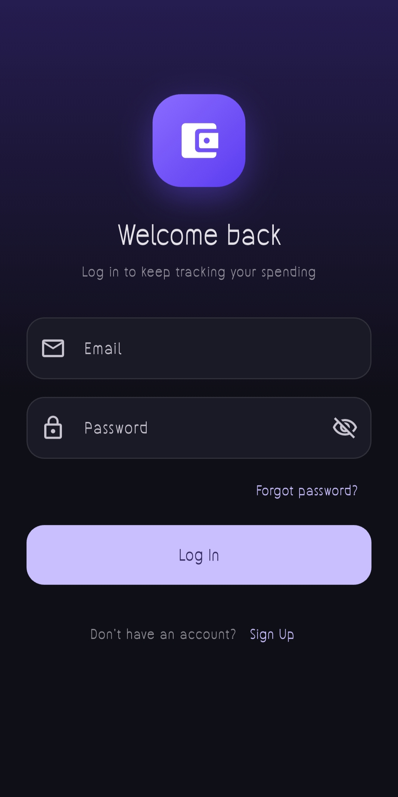
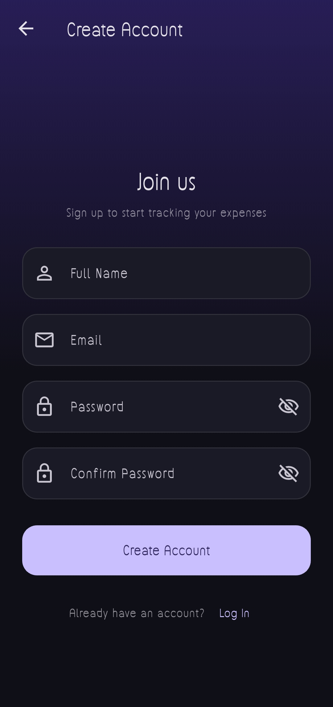
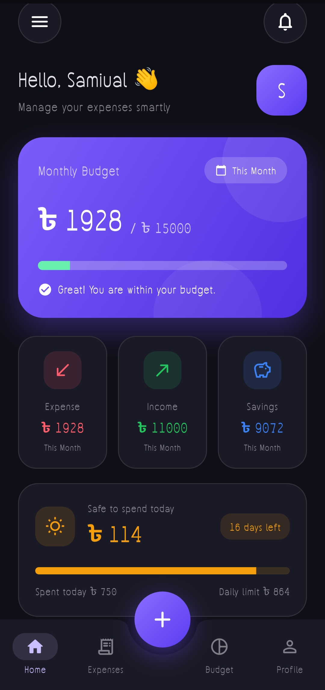
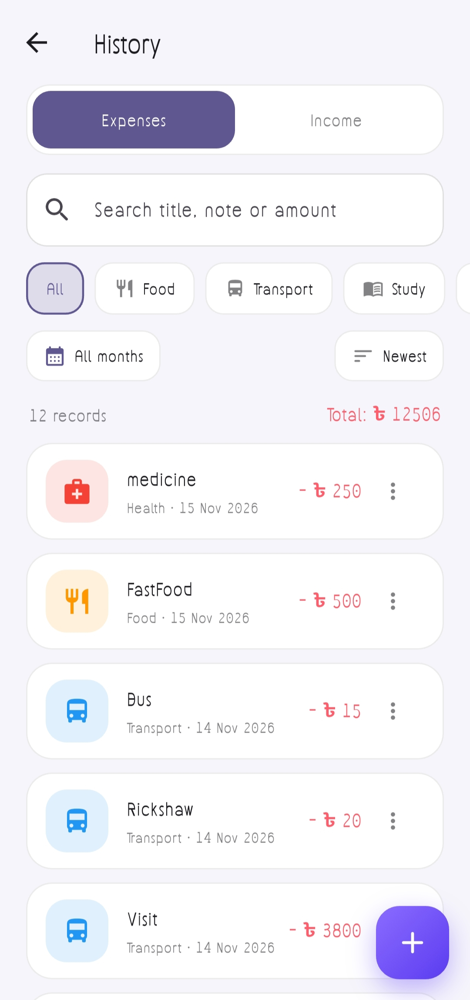
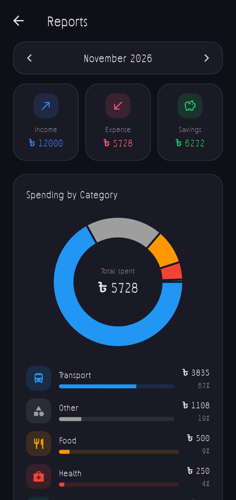

<div align="center">


# Student Monthly Expense Manager

**A premium Flutter + Firebase app that helps students track income, control spending and reach savings goals.**

[](https://flutter.dev)
[](https://dart.dev)
[](https://firebase.google.com)
[](https://www.android.com)
[](https://m3.material.io)


[Features](#-features) •
[Screenshots](#-screenshots) •
[Tech Stack](#-tech-stack) •
[Getting Started](#-getting-started) •
[Architecture](#-architecture) •
[Team](#-team)

</div>

---

## 📖 About

**Student Monthly Expense Manager** is built for the way students actually spend money: small daily payments like rickshaw, chai and lunch, a fixed monthly pocket money, and a constant worry about running out before the month ends.

Instead of just listing transactions, the app tells you **how much you can safely spend today**, shows **where your money goes**, warns you **before you cross your budget**, and helps you **save towards a goal**, all in a clean, modern interface with light and dark themes.

---

## ✨ Features

### 💰 Smart money tracking
| | Feature | Description |
|---|---|---|
| ➕ | **Income & Expense** | Add, edit and delete transactions with title, amount, category, date and note |
| ⚡ | **Quick Add** | One tap adds common expenses (Rickshaw, Bus, Chai, Snacks, Lunch, Recharge) with an Undo option |
| 🌤️ | **Safe to spend today** | Daily limit calculated from your budget and the days left in the month |
| 💡 | **Spending insights** | Weekly trend vs last week, top category and average spend per day |

### 🎯 Budget & savings
| | Feature | Description |
|---|---|---|
| 🎯 | **Monthly budget** | Set a budget with a live progress ring (turns orange and red as you approach the limit) |
| 🔔 | **Budget alerts** | Warnings when you cross spending thresholds |
| 🏷️ | **Category limits** | Set a monthly limit per category (Food, Transport...) with orange and red alerts |
| 🐷 | **Savings tracker** | Monthly and all-time savings at a glance |
| 🏁 | **Savings goal** | Name a goal, set a target and watch the progress bar fill |

### 📊 Reports & history
| | Feature | Description |
|---|---|---|
| 📋 | **Transaction history** | Search, filter by category and month, sort by date or amount |
| 👆 | **Swipe to delete** | Swipe left on any record, tap to edit |
| 🍩 | **Donut chart** | Spending breakdown by category with percentages |
| 📈 | **6-month bar chart** | Income vs expense trend |
| 📄 | **PDF export** | Download a monthly report |

### 🎨 Experience
| | Feature | Description |
|---|---|---|
| 🌗 | **Light / Dark mode** | Premium purple theme, saved across launches |
| 👤 | **Editable profile** | Name, phone, university, department and student ID |
| 🔐 | **Secure auth** | Firebase Authentication with email/password and password reset |
| ☁️ | **Real-time sync** | Cloud Firestore keeps your data safe and up to date |
| ✨ | **Splash and onboarding** | Animated splash and a 3-page intro on first launch |
| 🧹 | **Reset all data** | Clear all records from Settings (with confirmation) |

---

## 📸 Screenshots

<div align="center">

| Login | Register | Home |
|:---:|:---:|:---:|
|  |  |  |

| Add Income | History | Budget & Savings |
|:---:|:---:|:---:|
|  |  |  |

| Reports | Profile & Settings |
|:---:|:---:|
|  |  |

</div>

---

## 🛠️ Tech Stack

| Layer | Technology |
|---|---|
| **Framework** | Flutter 3 (Dart, Material 3) |
| **Authentication** | Firebase Authentication |
| **Database** | Cloud Firestore (real-time streams) |
| **State management** | Provider |
| **Charts** | fl_chart |
| **PDF export** | pdf, path_provider, open_file |
| **Local storage** | shared_preferences |
| **Formatting** | intl |

---

## 🏗️ Architecture

```
lib/
├── main.dart                 # App entry, global premium theme, AuthGate
├── firebase_options.dart     # Firebase configuration
├── models/
│   └── tx_item.dart          # Transaction model
├── providers/
│   └── theme_provider.dart   # Light / dark theme state
├── services/
│   ├── auth_service.dart     # Register, login, logout, reset password
│   └── firestore_service.dart# Transactions, budgets, goals
├── screens/
│   ├── splash_screen.dart
│   ├── onboarding_screen.dart
│   ├── login_screen.dart
│   ├── register_screen.dart
│   ├── home_screen.dart
│   ├── add_transaction_screen.dart
│   ├── expenses_screen.dart  # History
│   ├── budget_screen.dart
│   ├── report_screen.dart
│   └── settings_screen.dart
├── widgets/
│   ├── insights_card.dart    # Spending insights
│   └── category_budget_card.dart # Category limits
└── utils/
    └── helpers.dart          # Categories, icons, colors, calculations
```

### 🗄️ Firestore data model

```
users/{uid}
 ├── name, email, phone, university, department, studentId
 ├── expenses/{id}   → title, amount, category, date, note
 ├── incomes/{id}    → title, amount, category, date, note
 ├── budgets/{YYYY-MM} → amount, categories (per-category limits)
 └── goals/main      → title, target
```

Each user can only access their own data.

---

## 🚀 Getting Started

### Prerequisites
- [Flutter SDK](https://docs.flutter.dev/get-started/install) (stable)
- Android Studio or VS Code
- An Android phone with USB debugging on, or an emulator
- A Firebase project (Authentication + Cloud Firestore enabled)

### 1. Clone the repository
```bash
git clone https://github.com/samiual67/student-expense-manager.git
cd student-expense-manager
```

### 2. Install packages
```bash
flutter pub get
```

### 3. Connect Firebase
```bash
dart pub global activate flutterfire_cli
flutterfire configure
```
This generates `lib/firebase_options.dart` and `android/app/google-services.json` for your own Firebase project.

### 4. Run the app

**On an Android phone**
```bash
flutter devices
flutter run -d <device-id>
```

**On Chrome**
```bash
flutter run -d chrome
```

> ⚠️ PDF export uses `open_file`, which works on Android but may not work on web.

### Useful commands
| Command | Purpose |
|---|---|
| `r` | Hot reload |
| `R` | Hot restart |
| `flutter analyze` | Check code for errors |
| `flutter clean` | Fix stubborn build problems |
| `flutter build apk --release` | Build a release APK |

---

## 🗺️ Roadmap

- [x] Premium Material 3 redesign (light and dark)
- [x] Safe to spend today
- [x] Quick Add
- [x] Spending insights
- [x] Editable profile
- [x] Splash screen and onboarding
- [x] Category-wise budget limits
- [x] Reset all data and Undo for Quick Add
- [ ] Wallet balances (Cash, bKash, Bank)
- [ ] Bangla / English language switch
- [ ] CSV export

---

## 👥 Team

<div align="center">

| | **Member 1** | **Member 2** |
|:---:|:---:|:---:|
| **Name** | Md. Samiual Mia | Md Hasan Ruhanee Ruhan |
| **Student ID** | 0322410105101001 | 0322410105101010 |
| **Role** | UI/UX design, Flutter frontend development, Firebase integration | Database management, testing, documentation, report preparation |
| **GitHub** | [@samiual67](https://github.com/samiual67) | |

</div>

---

## 📄 License

This project was created for academic purposes as part of a university course.

---

<div align="center">

**Made with ❤️ using Flutter and Firebase**

⭐ Star this repo if you found it useful!

</div>
